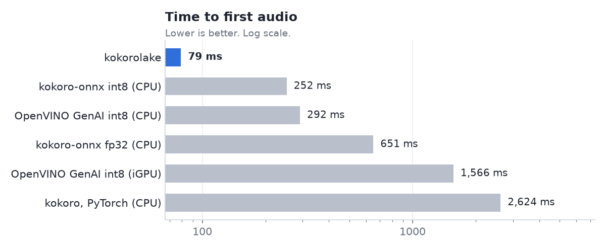
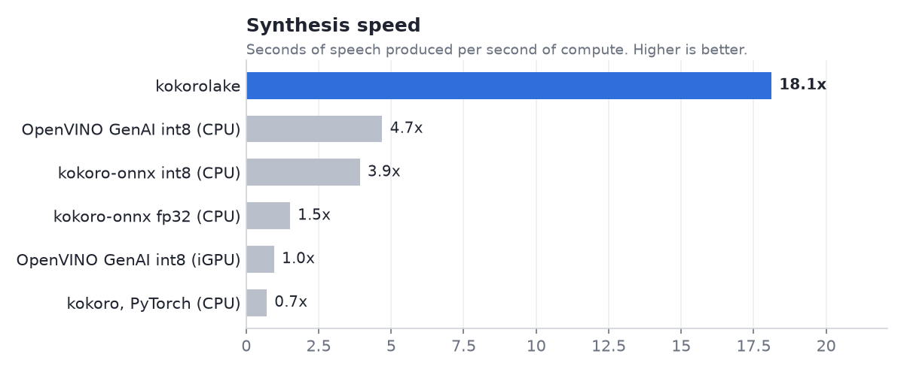
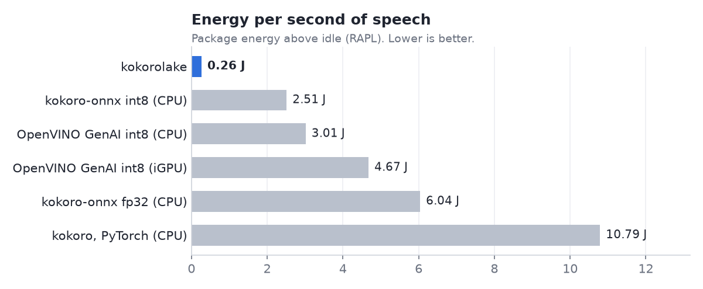
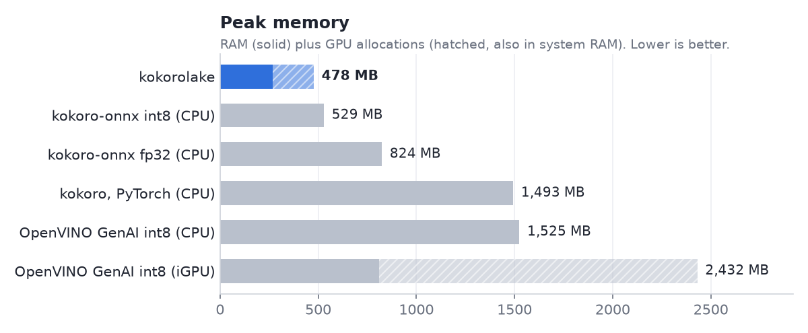
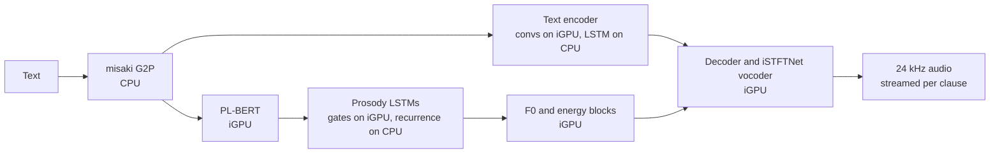

# kokorolake

kokorolake runs [Kokoro-82M](https://huggingface.co/hexgrad/Kokoro-82M) text-to-speech on Intel Core Ultra 200H (Arrow Lake) laptops. It reaches the first audio in about 80 ms, uses a fraction of a watt while speaking, and needs no PyTorch or OpenVINO at runtime.

The model and its voice are unchanged. What changes is where each part runs and how. The PL-BERT encoder, the decoder and the iSTFTNet vocoder run as hand-written OpenCL kernels on the matrix engines (XMX) of the integrated Arc GPU. The LSTM recurrences run in Rust on the CPU. Speech is streamed clause by clause.

On a Core Ultra 5 225H, compared with the usual ways of running Kokoro on this chip:

| | kokorolake | kokoro (PyTorch) | kokoro-onnx int8 | OpenVINO GenAI int8 |
|:--|--:|--:|--:|--:|
| Time to first audio | **79 ms** | 2,624 ms | 252 ms | 292 ms (CPU) |
| Speed (speech seconds per compute second) | **18.1x** | 0.7x | 3.9x | 4.7x (CPU) |
| Energy per second of speech | **0.26 J** | 10.79 J | 2.51 J | 3.01 J (CPU) |
| Peak memory (RAM + GPU) | **478 MB** | 1,493 MB | 529 MB | 1,525 MB (CPU) |









## How it works



| Stage | Runs on | Notes |
|:--|:--|:--|
| Grapheme to phoneme | CPU | misaki, with a compact lexicon and a slimmed spaCy pipeline; identical phonemes |
| Text encoder | iGPU and CPU | three convolutions and the LSTM input gates on the GPU, the recurrence on a CPU thread that overlaps BERT |
| PL-BERT (ALBERT, 12 shared layers) | iGPU | split-K matrix kernels for short token sequences, subgroup attention |
| Duration and prosody LSTMs | iGPU and CPU | gates as one GEMM on the GPU, recurrence in Rust (AVX2, F16C) |
| F0 and energy predictor | iGPU | six AdaIN residual blocks |
| Harmonic source, STFT | iGPU | exact-precision sine path, hash-based Gaussian noise |
| Decoder, generator, iSTFT | iGPU | the bulk of the compute; the host receives finished samples |

### What made the difference

**Exact-length kernels on the matrix engines.** Kokoro's decoder normalises every layer over the whole utterance, so padding inputs to a fixed size changes the output. OpenVINO's GPU plugin works around dynamic shapes by compiling a new kernel per input length, which costs seconds per new sentence. kokorolake's kernels take the length at run time. Convolutions use `intel_sub_group_f16_f16_matrix_mad_k16` (DPAS). Instance-norm statistics are reduced in the convolution epilogues, and normalisation is fused with the following activation.

**Zero-copy transfers.** The iGPU shares RAM with the CPU. All host and device exchanges therefore go through page-aligned buffers created with `CL_MEM_USE_HOST_PTR`, which both sides access in place. A write, kernel and read round trip takes 18 µs this way, against 430 µs through `clEnqueueReadBuffer` and `clEnqueueWriteBuffer`. That matters because the prosody stage alternates between GPU and CPU several times per clause.

**Direct submission.** Intel's compute runtime can let the GPU poll a ring buffer for new work instead of going through the kernel driver for every batch. Setting `EnableDirectSubmission=1` makes the decoder about 15% faster. OpenVINO enables this implicitly. Plain OpenCL queues do not get it by default. Idle power is unchanged.

**Keeping the CPU quiet.** CPU and GPU share one package power budget, and on this laptop the GPU is held near 1 GHz by the power limit. numpy's OpenBLAS left about eight threads spin-waiting after every small matrix product. On its own that slowed the GPU decoder from 72 to 122 ms. kokorolake forces single-threaded BLAS and sleeps instead of spinning while waiting for the GPU. It moved every stage that the GPU does better off the CPU. The CPU now spends about 20 ms of compute per second of speech.

**Rust for the sequential part.** An LSTM step depends on the previous one, so the recurrence stays on the CPU. Its input projections, which are most of the arithmetic, are batched into one GEMM on the GPU. The Rust kernel keeps the recurrent weights in fp16, converts them with F16C, and runs both directions on their own threads.

**Less resident memory.** Dropping OpenVINO removed about 570 MB of plugin and heap memory. Storing misaki's 365,000-entry pronunciation dictionary as one UTF-8 blob with offsets saved 57 MB, with phonemes identical on a test set covering numbers, heteronyms, names and acronyms. Generator activations share five buffers, chosen by liveness. Weights are streamed from disk one tensor at a time while they are packed.

**The NPU stays free.** The NPU was evaluated for every stage. It has no kernel for LSTMs and runs Kokoro's decoder six times slower than the iGPU. Its fp16 accumulation also degrades the decoder's output, and it is slower than the iGPU for BERT. The NPU is better used for speech recognition, which can run alongside.

## Fidelity

kokorolake computes in fp16 and the reference in fp32. `tools/verify.py` compares the two with Kokoro's random noise source disabled, and also compares the reference against itself across noise seeds, which is the variation Kokoro has by design.

| Sentence | Frames (kokorolake / reference) | Pitch error, median (p95) | Spectral distance to reference | Reference vs itself |
|:--|--:|--:|--:|--:|
| "Wait, what? All of the tests passed?" | 99 / 99 | 0.3 (0.7) cents | 3.2 dB | 2.1 dB |
| "Okay, but here's the bad news: the build broke..." | 224 / 224 | 0.3 (0.9) cents | 3.1 dB | 2.0 dB |
| "The meeting is at 3:45 PM on March 3rd; it costs $12.50." | 256 / 256 | 0.4 (1.1) cents | 3.6 dB | 1.9 dB |

Phoneme durations match exactly. Pitch stays within about one cent, well below the five cents people can hear. Listening side by side with the original PyTorch model, the only audible difference was the length of the pauses between sentences, which comes from kokorolake's chunking.

## Requirements

- An Intel GPU with SIMD8 DPAS, such as the Arc 130T or 140T in Core Ultra 200H processors. The kernels were developed and tested on a Core Ultra 5 225H only. Meteor Lake iGPUs have no XMX units. Lunar Lake's Xe2 GPU has them but works in SIMD16, so it would need SIMD16 variants of the kernels.
- Linux with Intel's compute runtime for OpenCL (`intel-compute-runtime`).
- Python 3.12. misaki does not support 3.13 or later.
- Rust (`cargo`) for the LSTM kernel.

## Installation

```sh
git clone https://github.com/sortedcord/kokorolake && cd kokorolake

# runtime
uv venv --python 3.12 .venv
uv pip install --python .venv/bin/python -r requirements.txt
cargo build --release --manifest-path rust/Cargo.toml

# one-time weight export (PyTorch on the CPU; not needed afterwards)
uv venv --python 3.12 .venv-tools
uv pip install --python .venv-tools/bin/python -r tools/requirements.txt
.venv-tools/bin/python tools/export.py --voice af_aoede
```

The export writes `weights/`. The voice pack is baked in at this step. To switch voices, run the export again with another voice name, such as `af_heart` or `bm_george`.

## Usage

```python
from kokorolake.engine import Engine

engine = Engine()  # about 2 s to start, 6 s on the very first run while kernels compile
for audio, timings in engine.stream("Hello there. This streams one clause at a time."):
    play(audio)  # float32 mono, 24 kHz
```

## Benchmarks

Every engine spoke the same 15-second passage in the same voice (`af_aoede`). The text was split into the same sentence and clause chunks, which were synthesised one after another. Time to first audio is the latency of the first chunk.

Each figure is the median of five to seven runs after a warm-up pass. Energy is the package energy from RAPL, minus idle power over the same interval. Memory is the peak resident set plus GPU allocations from DRM `fdinfo`. GPU allocations count because the integrated GPU's memory is system RAM.

| Engine | Time to first audio | Speed | Energy per second of speech | CPU time per second of speech | RAM | GPU |
|:--|--:|--:|--:|--:|--:|--:|
| kokorolake | 79 ms | 18.1x | 0.26 J | 0.02 s | 268 MB | 210 MB |
| kokoro-onnx int8 (CPU) | 252 ms | 3.9x | 2.51 J | 3.40 s | 529 MB | |
| OpenVINO GenAI int8 (CPU) | 292 ms | 4.7x | 3.01 J | 0.80 s | 1,525 MB | |
| kokoro-onnx fp32 (CPU) | 651 ms | 1.5x | 6.04 J | 8.93 s | 824 MB | |
| OpenVINO GenAI int8 (iGPU) | 1,566 ms | 1.0x | 4.67 J | 0.64 s | 809 MB | 1,623 MB |
| kokoro, PyTorch (CPU) | 2,624 ms | 0.7x | 10.79 J | 16.94 s | 1,493 MB | |

The machine was a Core Ultra 5 225H with 16 GB RAM, Arch Linux (kernel 7.2), compute runtime 26.40, on a USB-C charger. It was running a normal desktop session during the runs, including a browser and an animated wallpaper, so these are everyday numbers rather than best cases.

The versions tested were kokoro 0.9.4 (PyTorch 2.15, CPU), kokoro-onnx 0.4.7 (onnxruntime 1.32), and OpenVINO GenAI 2026.4 with Intel's `OpenVINO/Kokoro-82M-int8-ov` export. OpenVINO on the iGPU compiles a kernel set for each new input length. Its numbers were taken after three extra warm-up passes, and its first pass over the passage took 18 seconds.

To reproduce, run one engine per process in its own environment, then draw the charts:

```sh
.venv/bin/python bench/compare.py kokorolake 7 > bench/results/kokorolake.json
.venv-tools/bin/python bench/compare.py kokoro-pytorch > bench/results/kokoro-pytorch.json
KOKORO_ONNX_DIR=~/kokoro-onnx python bench/compare.py kokoro-onnx-int8 > bench/results/kokoro-onnx-int8.json
KOKORO_OV_DIR=~/Kokoro-82M-int8-ov python bench/compare.py openvino-cpu > bench/results/openvino-cpu.json
.venv-tools/bin/python bench/plot.py
```

The kokoro-onnx and OpenVINO runs need their own environments (`pip install kokoro-onnx` or `openvino-genai`) and model files: `kokoro-v1.0.onnx`, `kokoro-v1.0.int8.onnx` and `voices-v1.0.bin` from the kokoro-onnx releases, and the `OpenVINO/Kokoro-82M-int8-ov` repository from Hugging Face. Reading RAPL energy counters needs permission: `sudo chmod a+r /sys/class/powercap/intel-rapl:0/energy_uj`.

## Limitations

- English with an American accent and one voice per export.
- A single chunk can be at most 6.4 seconds of speech. Longer sentences are split at the nearest pause.
- fp16 throughout the GPU path, as described under Fidelity.
- Tested on one machine and one GPU generation.

## Project layout

```
kokorolake/engine.py   pipeline, chunking, streaming
kokorolake/gpu.py      OpenCL kernels and their host code (BERT, F0/N blocks, decoder, DSP)
kokorolake/front.py    text encoder and prosody predictor (GPU gates plus Rust recurrences)
kokorolake/lstm.py     ctypes binding for the Rust LSTM kernel
kokorolake/g2p.py      misaki with a compact lexicon and slim spaCy
rust/                  LSTM recurrence (AVX2, F16C)
tools/                 weight export, fidelity check, PyTorch reference pieces
bench/                 benchmark harness, results, charts
```

## Credits and license

Kokoro-82M is by [hexgrad](https://huggingface.co/hexgrad/Kokoro-82M) and released under Apache 2.0. It builds on StyleTTS 2 and iSTFTNet. Phonemes come from [misaki](https://github.com/hexgrad/misaki), with spaCy and espeak-ng as its fallback.

kokorolake is released under the Apache License 2.0; see [LICENSE](LICENSE).
